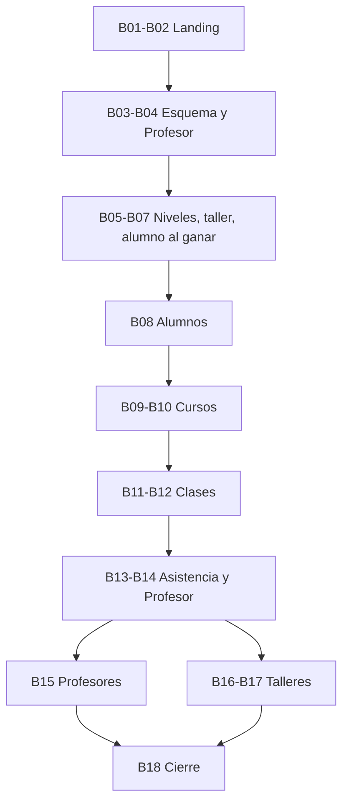

# Plan bonus: Fluency para academias de inglés

Fecha: 09/11/2026. Estado: **plan aprobado por el usuario; implementación no iniciada**. Seguimiento de tareas en [todo.md](todo.md). Complementa, sin reemplazarlos, el [plan](../../tasks/plan.md) y el [plan express](../../tasks/plan-express-pre-entrega.md) ya cerrados (T48,5 y T49).

## 1. Objetivo y marco

El CRM funciona pero se ve genérico para una academia de inglés. Este bonus lo adapta en dos días (09 y 10/11, colchón el 11/11), una sola persona en serie:

1. **Landing pública** en `/`, con **Contacto** (abre `mailto`) e **Ingresar** (lleva al login de siempre).
2. **Dominio académico:** Alumnos, Cursos, Clases (calendario/lista, asistencia, exámenes con notas), Talleres, rol **Profesor** con niveles propios, pestaña Profesores para el administrador y asistencia «13/33» en el perfil.

**Reglas de trabajo, más laxas que en los planes anteriores.** Rigen [AGENTS.md](../../AGENTS.md) y [CONSTRAINTS](../../CONSTRAINTS.md) en lo esencial (secretos, aislamiento de bases, identidad desde la sesión del servidor, no debilitar pruebas ni seguridad), con estas relajaciones:

- Tests focalizados por tarea; suites completas solo en el cierre B18.
- Revisión propia por tarea; **una** revisión independiente, centrada en los permisos del Profesor, antes de integrar.
- Sin documentos de evidencia por tarea: una línea de evidencia en [todo.md](todo.md) basta.
- Sin dependencias nuevas. Sin SPEC por módulo: las decisiones de §3 son la especificación.

**Esto deja sin efecto, por decisión expresa del usuario**, las exclusiones previas: [diseño §«especialización en academia»](../segunda-entrega/diseño-segunda-entrega.md) (sin alumnos, asistencia ni cursadas), [plan express §3](../../tasks/plan-express-pre-entrega.md) (cursos, clases, Profesor, asistencia y notas «postergados») y la nota «rol Profesor postergado» de [T49](../../tasks/todo.md#t49) y [publicación](../segunda-entrega/publicacion-azure.md). Esos documentos se conservan como historia.

## 2. Punto de partida comprobado (09/11/2026)

- Backend ASP.NET Core con controladores, servicios (`Services/Implementations`), DTO (`Services/DTO/*Contracts.cs`) y modelos EF a mano (`Persistence/Models`, `FluencyLocalDbContext.cs`). **Sin migraciones EF:** el esquema son scripts SQL en `backend/Persistence/SQL/` ejecutados a mano con guarda de base destino.
- Tres roles fijos (`ADMINISTRADOR`, `RESPONSABLE_COMERCIAL`, `VENDEDOR`) y siete permisos en `Services/Acceso/RolesYPermisos.cs`; policies en `FluencyAPI/Authentication/AuthenticationSetup.cs`; capacidades en `CapacidadesUsuario.cs`.
- **Hallazgo de seguridad:** Empresas, Contactos, Oportunidades, Actividades, `/inicio/resumen`, listados de Servicios/Embudos y opciones de catálogos no tienen policy por atributo; solo `FallbackPolicy` (usuario autenticado) y comprobaciones dentro de los servicios. Un Profesor autenticado podría filtrarse por una ruta mal protegida: ver B04.
- `Servicio` ya tiene `IdNivel` (catálogo A1–C2) y `IdModalidad`; la oportunidad llega al servicio por etapa → embudo → servicio. `OportunidadService.CloseAsync`/`PromoverAClienteAsync` ya promueve Potencial → Cliente al ganar, en transacción.
- Frontend React + MUI tema oscuro (`app/providers.tsx`, primary `#62BDB5`, Source Sans 3), router en `App.tsx` (solo `/login` pública), menú lateral en `app/AuthenticatedShell.tsx`, fichas con `features/shared/RecordProfile.tsx`, tipos en `api/schema.d.ts` (generado). `ProtectedRoute` solo comprueba autenticación: no hay guarda por permiso.
- Una landing anterior (T30c) y un rediseño (T30b) se **revirtieron el 05/11/2026** porque las pantallas se veían descentradas ([ejemplos](../../Referencias/mal-centrado/)). Este plan es la decisión nueva que esa reversión pedía.

## 3. Decisiones

**Confirmadas por el usuario:** Servicio tendrá la casilla **«Es taller»**; Responsable comercial y Vendedor **no ven nada académico**; «Contacto» abre `mailto` directo; ejecución en serie.

| Tema | Decisión |
|---|---|
| Alumno | No es un estado nuevo del catálogo: es la **existencia de una fila `alumno`** (derivado). Una empresa nunca es alumno; sí el contacto de la oportunidad ganada. |
| Cuándo se crea | Al ganar, dentro de la transacción de `CloseAsync`, si la oportunidad tiene **contacto** y su servicio es de **tipo Clases** (siempre con nivel; desde el 09/11/2026 el taller se distingue por su tipo, no por un indicador). Si el contacto ya es alumno no se duplica ni se cambia. Reabrir no lo revierte (igual que Potencial → Cliente). Desde el 12/11/2026 el **Administrador** también da de alta alumnos desde «Nuevo alumno» (contacto Cliente que aún no es alumno, con nivel y curso opcional; `POST /alumnos`, candidatos en `GET /alumnos/candidatos`) y puede cambiar el nivel (`PUT /alumnos/{id}/nivel`; si el curso es de otro nivel queda sin curso). El Profesor edita nivel y curso solo dentro de sus niveles/cursos. |
| Datos del alumno | Los personales se leen del contacto (FK única, sin duplicar columnas). El nivel se guarda en `alumno`. |
| Curso | Nombre, nivel y profesor. El nivel debe estar entre los niveles del profesor y coincidir con el del alumno que se suma. Un alumno tiene **un solo curso** (`alumno.id_curso` nullable); si ya tiene otro: 409. Desde el 12/11/2026 el curso del alumno se asigna, cambia o quita (`PUT /alumnos/{id}/curso`, mismo nivel) y el curso se puede dar de baja (`DELETE /cursos/{id}`: sus alumnos quedan sin curso y sus clases dejan de listarse). |
| Clase | Título, fecha (el día clickeado), hora de inicio y fin (se muestra como subtítulo), curso, `es_examen` y `temas_examen` opcional. El Profesor solo crea en sus cursos; el Administrador elige profesor y luego uno de sus cursos. |
| Asistencia y notas | Tabla `clase_alumno(id_clase, id_alumno, presente, nota)` con upsert. Sin fila = «sin registrar», cuenta como no asistió. Nota 0–10, decimales permitidos, opcional. |
| «13/33» | Presentes / clases **del curso con fecha ≤ hoy**. Alumno sin curso: «sin curso». |
| Vista «Lista» | Lista de **clases** (el pedido dice «cursos», probable errata). |
| Taller | Título, fecha única, horario y `id_servicio` (servicio de tipo Talleres). Inscribibles: contactos Cliente **con oportunidad ganada de ese servicio** ∪ alumnos; se inscribe el contacto y se muestran lista y cantidad. Gestionan Administrador y Profesor. Sin quitar inscripción (extra). |
| Profesor y datos | No usa `/contactos`: tiene `/alumnos/:id` (sin historial comercial) con `RecordProfile`. El bloque de asistencia es un componente compartido con la ficha de contacto, donde lo ven Administrador, Responsable y Vendedor. |
| Inicio | La tarjeta «Alumnos» pasa a contar filas `alumno` activas (hoy cuenta contactos Cliente, [plan express §4](../../tasks/plan-express-pre-entrega.md)); actualizar su SPEC y test. El Profesor entra a `/clases`. |

### Permisos

| Superficie | Administrador | Profesor | Responsable / Vendedor |
|---|---|---|---|
| Comercial (empresas, contactos, oportunidades, embudo, actividades, servicios, configuración) | Según rol actual | **Nada** (403) | Según rol actual |
| Usuarios (crear Profesor) | Sí | No | No |
| Alumnos | Todos | Solo los de **sus niveles** | No ven la pestaña; la asistencia aparece en la ficha de contacto |
| Cursos, Clases | Todos | Solo propios | No |
| Talleres | Sí | Sí | No |
| Profesores (pestaña) | Sí | No | No |
| Niveles propios | — | Los tilda en su Perfil | — |

Nuevo permiso `GestionarAcademia` para Administrador y Profesor; rol `PROFESOR`. Un Administrador puede además ver todo lo académico. Frontend: guarda de ruta por permiso y menú condicional; **la API es la autoridad** y cada servicio revalida actor y propiedad.

### Ajustes de implementación (09/11/2026)

- El rol y el permiso viven en un segundo script aditivo e idempotente, `segunda-entrega-bonus-roles.sql` (el de roles base se rechaza si la identidad ya tiene datos). `levantar-bonus-academia.ps1` aplica ambos en desarrollo, con las guardas de destino de los otros scripts.
- `clase_alumno.presente` admite NULL = sin registrar (una nota cargada no implica asistencia).
- `GET /profesores` (solo Administrador) cubre la API de B15. Las fichas comerciales leen lo académico con `GET /contactos/{id}/academico` (política comercial), porque Responsable y Vendedor no tienen el permiso académico.
- Al agregar la política `ConsultarComercial` a todos los controladores comerciales (B04), la pestaña de Catálogos, Servicios y demás quedó cerrada al Profesor también en el servidor; sus opciones de nivel salen de `GET /profesores/yo/niveles` y las de taller de `GET /talleres/servicios`.
- **Decisiones tras la revisión independiente de permisos (09/11/2026):** sin fugas comerciales ni IDOR. Se corrigió el rango de la nota (el `Range` entero redondeaba) y se serializó el cambio de niveles. Se aceptan expresamente, por coherencia con el pedido: (a) los talleres los gestionan Administrador y Profesor y sus candidatos muestran nombre y documento de alumnos y de clientes con el taller ganado, sin filtrar por nivel; (b) el Profesor ve la asistencia de cualquier alumno de sus niveles, aunque esté en el curso de otro profesor del mismo nivel; (c) una petición de alta con ids de alumno ajenos distingue 400 y 409, sin exponer datos personales.
- El inicio del Profesor es `/clases`. La guarda del frontend oculta lo comercial a quien tiene solo `GestionarAcademia`.

### Esquema

Archivo incremental **`backend/Persistence/SQL/segunda-entrega-bonus.sql`**: aditivo, con guarda de base destino como los scripts actuales, sin tocar los base. El fixture `CommercialSchemaFixture.cs` lo aplica. Contenido: `servicio.es_taller`; tablas `profesor_nivel`, `alumno` (UNIQUE `id_contacto`), `curso`, `clase` (hora fin > inicio), `clase_alumno` (nota 0–10), `taller`, `taller_inscripcion`; FKs `RESTRICT`; rol `PROFESOR` y permiso `GestionarAcademia`. Aplicarlo a la base de desarrollo exige comprobar destino y estado; **a Supabase/Azure lo aplica el usuario con backup** (pendientes de [publicación §10](../segunda-entrega/publicacion-azure.md)).

## 4. Landing (B01–B02)

Estructura **inspirada, no calcada**, en woker.ar: barra con logo, anclas y botones a la derecha; hero con etiqueta, titular, subtítulo, CTA y mockup; franja; «por qué elegirnos» con bloques alternados; módulos con barra de anclas; FAQ; CTA final; footer. Diferencias propias: botones **Contacto** (`mailto`) e **Ingresar** (`/login`); franja con los niveles A1–C2 en lugar de logos; mockup armado con componentes (sin capturas con datos reales); **sin testimonios inventados**.

Contenido tomado del [PDF «Oh My GADS»](../../Referencias/Segunda%20Entrega%20-%20Oh%20My%20GADS.pdf) (TP 2–9):

| Sección | Mensaje y fuente |
|---|---|
| Hero | De la desorganización y la información dispersa a gestionar la academia desde un único lugar (propuesta A→B); «Gestioná tu academia de inglés de forma más sencilla» (mensaje de «Atraer»). |
| Dolores | Información descentralizada; alumnos, grupos y horarios sin control; no saber cuánto cuesta el desorden; herramientas difíciles de usar o con pocas funciones (customer experience y competencia). |
| Cómo funciona | Captar contactos y empresas → seguirlos en embudos por servicio → ganar y convertirlos en alumnos → organizar cursos, clases y asistencia (el embudo atraer/educar/convertir/fidelizar del TP). |
| Módulos | Solo los reales: Clientes, Embudos de venta, Actividades e historial, Alumnos, Cursos, Clases y asistencia, Talleres, Profesores. |
| Ventaja | Estadísticas de alumnos que crecen al sumar alumnos («experiencia WOW»), limitadas a lo que el inicio realmente muestre. |
| FAQ | Suscripción con período de prueba (modelo de negocio del TP), tipos de usuario (Administrador, Profesor, Vendedor), soporte, primer uso. |
| CTA final | «Agendá una reunión» (llamado a la acción de «Educar»). |

**Regla:** no prometer lo que el producto no hace (cobros o facturación, IA, integraciones, métricas inventadas). El PDF menciona control de cobros; se omite.

Rutas: `/` landing pública; sesión activa → `/inicio`; `*` → `/`; `/login` sin cambios (`frontend/vercel.json` ya reescribe todo a `index.html`). Correo de Contacto: variable `VITE_CONTACT_EMAIL`; **dato pendiente del usuario**, entre tanto un valor ficticio claramente marcado. No usar el correo de la cuenta de Claude.

**Lección de T30b/T30c:** contenedor propio (`maxWidth` + `mx: auto`) sin heredar el layout del shell; capturas a 360, 768 y 1280 px y revisión visual del usuario como criterio de aceptación, además de los tests. La revisión del usuario no bloquea el trabajo siguiente.

## 5. Orden, ritmo y línea de corte

Día 1 (09/11): B01–B08. Día 2 (10/11): B09–B15 y, si alcanza, B16–B17. 11/11: cierre B18 y colchón. Estimación honesta: unas 18 tareas de 1–1,5 h; el alcance completo es ajustado. **Orden de recorte:** primero Talleres (B16–B17), luego la pestaña Profesores (B15), luego la vista Lista de Clases. **No se recorta:** landing, alumno al ganar, Profesor con permisos, Cursos, Clases con asistencia y notas, asistencia en la ficha.

El orden sigue las dependencias de [todo.md](todo.md). No paralelizar escrituras que comparten `DbContext`, esquema, `Program.cs`, cliente HTTP o tipos generados.

## 6. Verificación

- **Por tarea:** `git diff --check`; build de lo tocado (`dotnet build backend/FluencyAPI.slnx --no-restore -m:1`; en `frontend`, `npm run build` y `npm run lint -- src vite.config.ts`); tests focalizados (`dotnet test … --filter "FullyQualifiedName~Clase"`, 3–6 min por clase de tests en segundo plano, sin recompilar mientras corren; `npm run test:run -- ruta`).
- **Tests que sí se escriben**, con PostgreSQL real y sin InMemory: alumno al ganar; matriz 403 del Profesor; filtro por niveles; curso (nivel, profesor, un solo curso); asistencia con upsert y razón X/Y; nota fuera de rango; candidatos de taller. UI: humo por página nueva y por la landing.
- **Tipos:** tras cada bloque backend, regenerar `schema.d.ts` con la API local (`dotnet run --no-build … --launch-profile http`, luego `npm run api:types`, detener la API); nunca a mano.
- **Cierre B18:** suites backend (~10–12 min) y frontend completas; recorrido manual local con Administrador, Profesor y Vendedor; revisión independiente de permisos; sin repetir seguridad ([T47](../segunda-entrega/verificacion-seguridad.md)) salvo cambios de dependencias.
- **Base:** aplicar el SQL incremental a la base de desarrollo solo tras comprobar destino y estado. Nada contra Supabase ni Azure. Los tests usan la base aislada de T03.

## 7. Git

Rama de trabajo `segunda-entrega-profesores`. Commits `feat:`/`fix:`/`test:` separados de `docs:`. `git add` con rutas explícitas: hay `.claude/` y `backend/FluencyAPI.Tests/Properties/` sin versionar que no deben entrar. Merge y publicación requieren OK específico; el merge a `master` dispara el despliegue del backend.

## 8. Riesgos y pendientes

| Riesgo | Tratamiento |
|---|---|
| Alcance mayor que dos días | Orden de recorte de §5; nunca se marca completo lo no verificado. |
| Profesor ve datos comerciales por rutas sin policy | Barrido por ruta en B04 y revisión independiente en B18. |
| Landing «descentrada» otra vez | Contenedor propio, capturas multi-ancho, revisión visual del usuario. |
| Esquema en producción | Script incremental más guía; lo ejecuta el usuario con backup. |
| «Ganada» con servicio mal configurado | Servicio sin nivel o taller no crea alumno; prueba explícita. |
| Sin «quitar inscripción» de taller | Limitación conocida; extra si sobra tiempo. «Quitar de curso» ya existe (12/11/2026). |
| **Dato pendiente del usuario** | Correo para `VITE_CONTACT_EMAIL`. |
